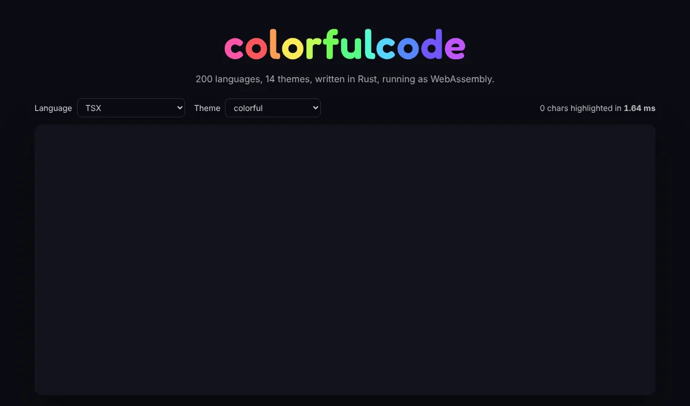
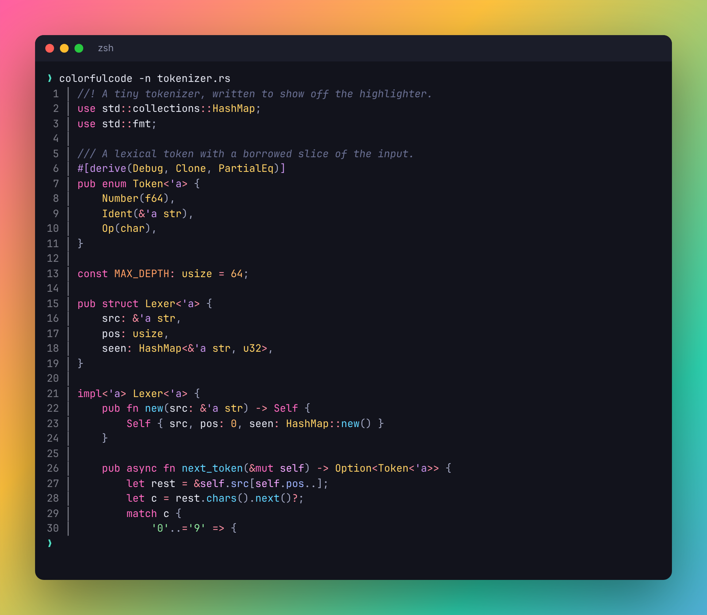
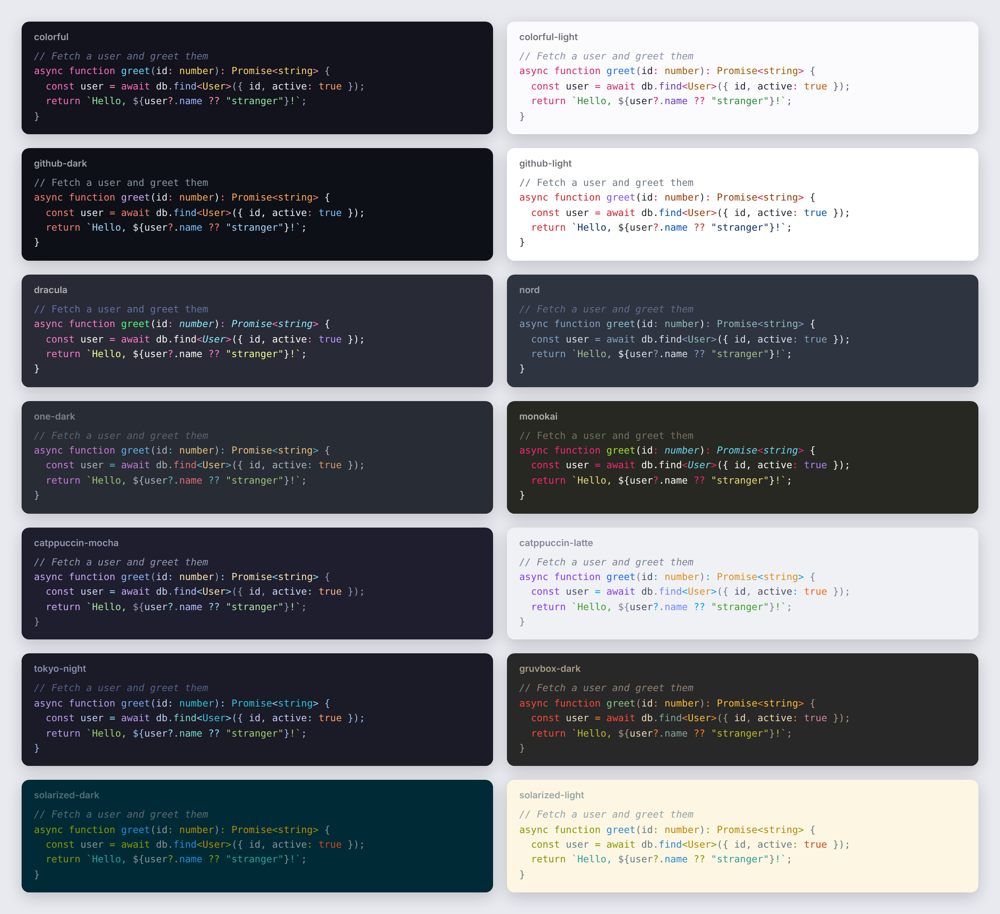
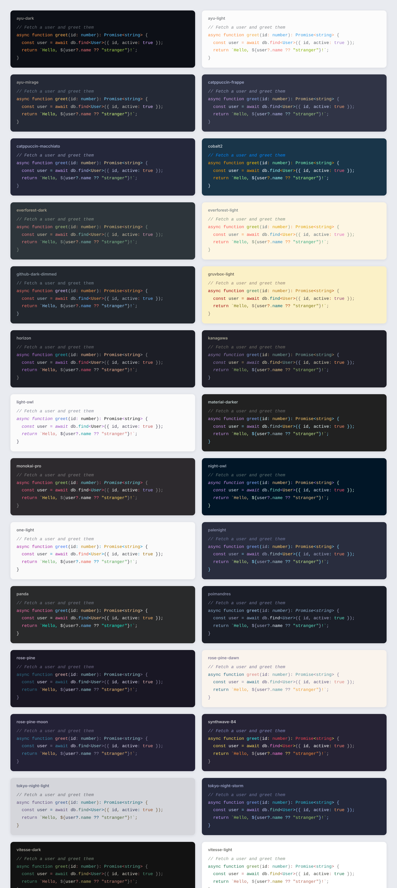
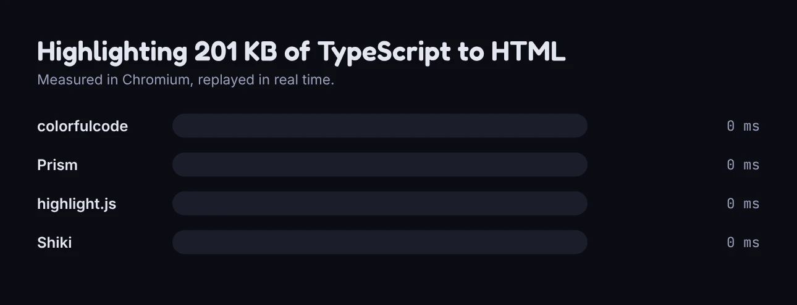

<p align="center">
  
</p>

<p align="center">
  Fast syntax highlighting for 200 languages, written in Rust.<br>
  Use it from React, plain JavaScript, native apps or the terminal.
</p>

<p align="center">
  <a href="https://github.com/Darker-Ink/colorfulcode/actions/workflows/ci.yml"></a>
</p>

<p align="center">
  
</p>

## Why

- **Fast.** Around 240 MB/s natively and 45 MB/s from JavaScript including HTML output. That is 11 to 33 times faster than Prism and highlight.js and over 100 times faster than Shiki ([benchmarks](#benchmarks)).
- **Lots of languages.** 200 languages, including embedded ones: scripts and styles in HTML, fenced code in Markdown, Vue and Svelte components, and TSX with generic arrow functions.
- **Small for what it does.** All 200 languages are 309 KiB gzipped, and the 55 most used ones are 130 KiB (`colorfulcode/common`). No dependencies.
- **Zero setup.** Synchronous, so it works in SSR, React Server Components, Node, Deno, Bun and every bundler without configuration.
- **Easy to render anywhere.** The output is a flat list of `(start, end, kind)` tokens plus theme colors, so native UIs can colorize text in a few lines.

## Install

```bash
npm install colorfulcode
```

```bash
cargo add colorfulcode
```

## React

```tsx
import { Code } from "colorfulcode/react";

export function Example({ source }: { source: string }) {
  return <Code code={source} language="tsx" theme="tokyo-night" lineNumbers highlightLines={[3]} />;
}
```

Everything is styled inline, so no CSS is needed. Pass `theme={false}` to get class names instead and bring your own stylesheet.

| Prop | Type | Default | |
| --- | --- | --- | --- |
| `code` | `string` | | The source. A string child works too. |
| `language` | `string` | `"text"` | Id, alias or file extension, for example `"ts"` or `"rs"`. |
| `theme` | `string \| object \| false` | `"colorful"` | A [theme](#themes) name or a [custom theme](#custom-themes) object for inline styles, or `false` for class names. |
| `lineNumbers` | `boolean` | `false` | Show line numbers. |
| `highlightLines` | `number[]` | | One based lines to highlight. |
| `inline` | `boolean` | `false` | Render a `<code>` for inline snippets instead of a `<pre>` block. |

Two hooks are exported as well: `useHighlight(code, language, options)` returns memoized HTML, and `useTokens(code, language)` returns memoized lines of `{ text, kind }` for rendering with your own components.

## JavaScript

```js
import { highlight, tokenize } from "colorfulcode";

const html = highlight("const answer = 42;", "js", { theme: "dracula" });
// <pre class="cc" style="background:#282a36;color:#f8f8f2"><code><span style="color:#ff79c6">const</span> ...

const tokens = tokenize("const answer = 42;", "js");
// [{ start: 0, end: 5, kind: "keyword", text: "const" }, ...]
```

| Function | Returns |
| --- | --- |
| `highlight(code, language, options?)` | HTML. Options: `theme` (name, theme object or `false`), `pre` (wrap in `<pre><code>`, default `true`), `lineNumbers`, `lines`, `highlightLines`. |
| `tokenize(code, language)` | `{ start, end, kind, text }[]` covering the whole input. Offsets are string indices. |
| `tokenizeLines(code, language)` | `{ text, kind }[][]`, one array per line. |
| `highlightAll(options?, root?)` | Highlights every `<code class="language-xyz">` in the page. |
| `highlightElement(element, options?)` | Highlights one element in place. |
| `detectLanguage({ path?, code? })` | A language id from a file name or a shebang. |
| `getLanguage(name)`, `listLanguages()` | Language info: `id`, `name`, `aliases`, `extensions`, `filenames`. |
| `getTheme(name)`, `listThemes()` | Theme info with every color. |
| `defineTheme(theme)` | Registers a [custom theme](#custom-themes) and returns its name. |
| `themeCss(theme, selector?)` | CSS for class based output. Also shipped as `colorfulcode/css/<name>.css`. |

Unknown languages fall back to plain text.

## Rust

```rust
use colorfulcode::{highlight, html, Language, Theme};

let rust = Language::find("rust").unwrap();
let highlighted = highlight("fn main() {}", rust);

// Walk the tokens yourself...
for (text, kind) in highlighted.iter() {
    println!("{kind}: {text:?}");
}

// ...or render them.
let theme = Theme::find("nord").unwrap();
let page = highlighted.to_html(&html::Options { theme: Some(theme), wrap: true, ..Default::default() });
let terminal = highlighted.to_ansi(theme, colorfulcode::ansi::ColorMode::TrueColor);
```

| Item | |
| --- | --- |
| `highlight(code, language) -> Highlighted` | Tokenizes the code. `highlight_into` reuses a token buffer. |
| `Highlighted` | `tokens()`, `iter()` of `(text, kind)`, `lines()`, `utf16_tokens()`, `to_html()`, `to_ansi()`. |
| `Token { start, end, kind }` | Byte offsets. Tokens cover the input exactly, with no gaps. |
| `Language` | `find(name)`, `from_path(path)`, `from_content(code)`, `all()`, `id()`, `name()`. |
| `Theme` | `find(name)`, `all()`, `new(...)` for [custom themes](#custom-themes), `style(kind)`, `background`, `foreground`, `to_css(selector)`. |
| `Kind` | The token category. See [kinds](#token-kinds). |

## Native apps

`crates/colorfulcode-ffi` builds a C library (`cdylib` and `staticlib`) with a header in [`include/colorfulcode.h`](crates/colorfulcode-ffi/include/colorfulcode.h). Swift, Kotlin, C#, C++ and anything else that can call C can use it.

```c
int32_t lang = cc_language_find("python");
int32_t theme = cc_theme_find("github-light");
cc_tokens *tokens = cc_highlight(code, len, lang, CC_UTF16_OFFSETS);

for (size_t i = 0; i < cc_tokens_len(tokens); i++) {
    const cc_token *t = &cc_tokens_data(tokens)[i];
    cc_style style = cc_theme_style(theme, t->kind);  // style.color is 0xRRGGBB
    // apply style to the range [t->start, t->end)
}
cc_tokens_free(tokens);
```

`CC_UTF16_OFFSETS` returns offsets in UTF-16 code units, which is what `NSString`, Java and Kotlin strings and .NET strings use. A full example lives in [`examples/c`](examples/c).

## Terminal

```bash
cargo install --path crates/colorfulcode-cli
colorfulcode src/main.rs
colorfulcode -n --theme dracula README.md
cat script.py | colorfulcode -l python
```

<p align="center">
  
</p>

Options: `-l/--language`, `-t/--theme`, `-n/--line-numbers`, `--color auto|always|never`, `--html`, `--list-languages`, `--list-themes`.

## Token kinds

`text`, `comment`, `keyword`, `string`, `escape`, `number`, `constant`, `function`, `type`, `variable`, `property`, `builtin`, `operator`, `punctuation`, `tag`, `attribute`, `meta`, `regex`, `heading`, `emphasis`, `strong`, `link`, `inserted`, `deleted`.

With `theme: false` each token gets the class `cc-<kind>`, for example `cc-keyword`.

## Themes

<p align="center">
  
</p>

`colorful` (default), `colorful-light`, `github-dark`, `github-light`, `dracula`, `nord`, `one-dark`, `monokai`, `catppuccin-mocha`, `catppuccin-latte`, `tokyo-night`, `gruvbox-dark`, `solarized-dark`, `solarized-light`.

### More themes

`colorfulcode/themes` has 28 more. They are plain theme objects, not part of the WebAssembly module, so they cost nothing unless you import them:

```tsx
import { rosePine } from "colorfulcode/themes";

<Code code={source} language="ts" theme={rosePine} />;
```

`rose-pine`, `rose-pine-moon`, `rose-pine-dawn`, `ayu-dark`, `ayu-mirage`, `ayu-light`, `night-owl`, `light-owl`, `palenight`, `material-darker`, `synthwave-84`, `kanagawa`, `everforest-dark`, `everforest-light`, `vitesse-dark`, `vitesse-light`, `poimandres`, `github-dark-dimmed`, `one-light`, `gruvbox-light`, `catppuccin-frappe`, `catppuccin-macchiato`, `tokyo-night-storm`, `tokyo-night-light`, `monokai-pro`, `horizon`, `panda`, `cobalt2`. Each export is the camelCase name, for example `tokyoNightStorm`.

<p align="center">
  
</p>

## Custom themes

A theme is a background, a foreground and colors for the [kinds](#token-kinds) you care about. Anything you leave out inherits something sensible: `tag` and `meta` borrow the `keyword` color, `builtin` borrows `function`, `escape` borrows `constant`, and so on.

For example, a theme in Discord's colors:

```js
import { defineTheme, highlight } from "colorfulcode";

defineTheme({
  name: "discord",
  background: "#2b2d31",
  foreground: "#dbdee1",
  styles: {
    comment: { color: "#80848e", italic: true },
    keyword: "#eb459e",
    string: "#57f287",
    number: "#f0b232",
    function: "#00a8fc",
    type: "#fee75c",
    property: "#c9cdfb",
    operator: "#949cf7",
    punctuation: "#b5bac1",
  },
});

highlight(code, "ts", { theme: "discord" });
```

In React, pass the object straight to `theme` and it is registered on first use:

```tsx
<Code code={source} language="ts" theme={discord} />
```

In Rust, build one with `Theme::new`:

```rust
use colorfulcode::{Color, Kind, Style, Theme};

static DISCORD: Theme = Theme::new("discord", true, Color::hex("#2b2d31"), Color::hex("#dbdee1"), &[
    (Kind::Comment, Style::new(Color::hex("#80848e")).italic()),
    (Kind::Keyword, Style::new(Color::hex("#eb459e"))),
    (Kind::String, Style::new(Color::hex("#57f287"))),
]);
```

Native apps usually skip themes altogether and map each kind to colors from their own design system.

## Smaller build

`colorfulcode` includes every language (309 KiB gzipped). If you only need the popular ones, `colorfulcode/common` has 55 of them (130 KiB gzipped) with the same API:

```js
import { highlight } from "colorfulcode/common";
import { Code } from "colorfulcode/common/react";
```

It covers JavaScript, TypeScript, JSX, TSX, HTML, CSS, SCSS, Less, Sass, JSON, Markdown, MDX, Vue, Svelte, Astro, Python, Rust, Go, Java, Kotlin, Swift, C, C++, C#, Objective-C, Dart, Scala, Zig, Haskell, Elixir, Ruby, PHP, Perl, Lua, R, Bash, PowerShell, Batch, Dockerfile, Makefile, nginx, SQL, GraphQL, YAML, TOML, INI, dotenv, HCL, Protobuf, XML, SVG, diff and plain text. In Rust the same set is what you get with `default-features = false`.

## Benchmarks

<p align="center">
  
</p>

The race above is measured in Chromium and replayed in real time (`cd bench && npm run race` runs it in your browser).
In Node 22, HTML output for about 100 KB of code per language (`bench/compare.mjs`):

| Language | colorfulcode | Prism | highlight.js | Shiki |
| --- | ---: | ---: | ---: | ---: |
| TypeScript | **44.7 MB/s** | 1.9 MB/s (24x slower) | 1.3 MB/s (33x slower) | 0.2 MB/s (211x slower) |
| Python | **54.1 MB/s** | 3.5 MB/s (15x slower) | 4.5 MB/s (12x slower) | 0.4 MB/s (155x slower) |
| Rust | **43.1 MB/s** | 2.4 MB/s (18x slower) | 3.2 MB/s (14x slower) | 0.4 MB/s (120x slower) |
| CSS | **44.9 MB/s** | 4.2 MB/s (11x slower) | 2.9 MB/s (15x slower) | 0.3 MB/s (144x slower) |

The core alone tokenizes at 240 MB/s on average across all sample files (`cargo run --release --example bench`).

## Languages

<details>
<summary>All 200 languages</summary>

ABAP, ActionScript, Ada, Agda, Alloy, Apache, Apex, APL, AppleScript, ARM Assembly, AsciiDoc, Assembly, Astro, AutoHotkey, AWK, Bash, BASIC, Batch, BibTeX, Blade, C, C#, C++, Caddyfile, Carbon, Clojure, CMake, COBOL, CoffeeScript, Common Lisp, Coq, crontab, Crystal, CSS, CSV, CUDA, CUE, Cypher, D, Dart, DAX, Diff, Dockerfile, DOT, Dotenv, EJS, Elixir, Elm, Emacs Lisp, ERB, Erlang, F#, Fennel, fish, Forth, Fortran, G-code, GDScript, Gherkin, Git Attributes, Git Config, Gleam, GLSL, GNU Assembler, Go, Go Template, Grain, GraphQL, Groovy, Haml, Handlebars, Hare, Haskell, Haxe, HCL, HLSL, HTML, HTTP, Hy, Idris, Ignore List, INI, Janet, Java, JavaScript, Jinja, JSON, JSON with Comments, JSON5, Jsonnet, JSX, Julia, Just, KDL, Koka, Kotlin, Kusto, LaTeX, Lean, Less, Liquid, LiveScript, LLVM IR, Log, Lua, Makefile, Markdown, MATLAB, MDX, Mermaid, Meson, Mojo, MoonScript, MQL, nginx, Nim, Ninja, Nix, Nushell, Objective-C, OCaml, Odin, OpenSCAD, Org, Pascal, Perl, PHP, Plain Text, PlantUML, Pod, Pony, PowerShell, Prisma, Procfile, Prolog, Properties, Protocol Buffers, Pug, PureScript, Python, QML, R, Racket, Raku, Razor, Reason, Regular Expression, reStructuredText, RISC-V Assembly, Roc, Roff, Ruby, Rust, SAS, Sass, Scala, Scheme, SCSS, Slim, Smalltalk, Solidity, SPARQL, SQL, Squirrel, SSH Config, Standard ML, Stata, Stylus, Svelte, SVG, Swift, systemd Unit, SystemVerilog, Tcl, Texinfo, Thrift, TLA+, TOML, TSV, TSX, Twig, TypeScript, Typst, Unison, V, Vala, VBA, Verilog, VHDL, Vim Script, Visual Basic .NET, Vue, WebAssembly Text, WGSL, Wolfram Language, Wren, XML, Xonsh, YAML, Zig

</details>

## Examples

- [`examples/react`](examples/react): the playground from the animation at the top (`npm run dev -w colorfulcode-react-example`).
- [`examples/vanilla`](examples/vanilla): a static page using `highlightAll`.
- [`examples/node`](examples/node): render a file to a standalone HTML page.
- [`examples/c`](examples/c): highlight a file through the C library.
- [`crates/colorfulcode/examples`](crates/colorfulcode/examples): Rust examples, including drawing tokens the way a native UI would.
- [`crates/colorfulcode-cli`](crates/colorfulcode-cli): the terminal app.

## Development

```bash
cargo test --workspace          # Rust tests, including snapshot tests for every language
npm install && npm run build    # build the WebAssembly module and the npm package
npm test                        # JavaScript and React tests
```

Each language has a sample in `crates/colorfulcode/tests/samples` and a snapshot of its tokens. Run `UPDATE_SNAPSHOTS=1 cargo test -p colorfulcode --test snapshots` after changing a lexer, then review the diff.

Two more tools help when working on a lexer: `cargo run --release --example fuzz <language>` looks for tokens that split characters, and `cargo run --release --example stress [language]` looks for inputs that make lexing slower than linear.

## License

MIT
